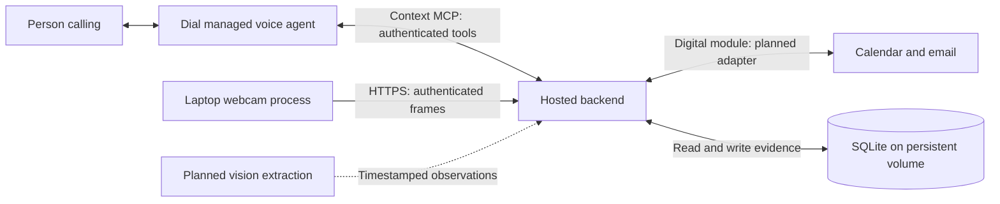

# speedhacks

Phone memory assistant hackathon scaffold. A person calls a number, asks about a plan or misplaced object, and hears an answer grounded in timestamped evidence.

**Infrastructure only:** the runnable MCP tools read labeled synthetic memories. Google accounts, Dial calls, and object detection are not connected. Webcam uploads do not identify objects.

## Proposed architecture



One monorepo, two running processes: a hosted Node backend and a Python webcam process on a laptop. Digital and physical memory are separate backend modules. They can be deployed independently later; the hackathon uses one backend deployment.

Dial owns speech recognition, conversation, and speech playback. Its managed voice agent calls the backend's MCP tools during the call. The camera collects evidence before a call; object lookup retrieves historical observations rather than describing only the current room.

The camera makes outbound HTTPS requests, requiring no public laptop port. The backend keeps only the latest raw frame, while object observations persist separately. Engineer 3 adds vision extraction and posts observations before camera capture can produce searchable memories. Photos and live-message adapters are stretch work.

## Ownership

| Engineer | Owns | Next work |
| --- | --- | --- |
| 1: Phone and deployment | `backend/voice/`, `backend/app.mjs`, Docker files | Connect Dial MCP, configure voice instructions, deploy and test a real call |
| 2: Digital memory | `backend/digital/` | Add Google authorization and Calendar/email retrieval with source references |
| 3: Physical memory | `camera/`, `backend/physical/` | Add vision extraction, placement observations, and last-seen validation |

`contracts/index.mjs` defines shared payload validation and tool inputs. Coordinate changes here before changing producers or consumers. Engineer 1 owns the shared backend deployment.

## Local startup

Requires Node 22.15.x–22.x and npm; optional camera capture uses Python 3.12+. Node's built-in SQLite API is experimental in this version.

```sh
npm ci
npm run setup
```

Setup creates an ignored, owner-readable `.env` with distinct secrets. It never overwrites an existing file. Set `DEMO_CALLER_NUMBER` there to a consented test caller's E.164 number, then:

```sh
npm start
```

Health: `http://127.0.0.1:3000/health`. MCP: `http://127.0.0.1:3000/mcp`. Watch mode: `npm run dev`.

`DEMO_MODE=true` seeds synthetic calendar, email, and keys memories dated today in UTC. Seeded records have `demo: true`. Setting the flag to false stops seeding but does not erase existing fixtures. This scaffold has one demo user and no connected Google account.

## Contracts

| Endpoint/tool | Authentication | Purpose |
| --- | --- | --- |
| `GET /health` | None | Liveness and demo status |
| `POST /mcp` | `Bearer DIAL_MCP_TOKEN` | Stateless Streamable HTTP MCP; other methods return 405 |
| `get_schedule({date})` | Authorized inbound demo caller | Plans for an explicit `YYYY-MM-DD` date |
| `search_messages({query})` | Authorized inbound demo caller | Search fixture emails |
| `find_object({object})` | Authorized inbound demo caller | Latest matching observation by capture time |
| `POST /camera/frame` | `Bearer CAMERA_TOKEN` | Store latest JPEG, at most 500 KB |
| `GET /camera/frame` | `Bearer CAMERA_TOKEN` | Retrieve latest JPEG with `X-Captured-At` |
| `POST /camera/observations` | `Bearer CAMERA_TOKEN` | Persist a placement observation |

Observation body:

```json
{
  "object": "keys",
  "location": "beside the blue mug on the desk",
  "timestamp": "2026-10-11T14:14:00-07:00"
}
```

Frame bodies contain `timestamp` and `jpegBase64`. The upload response explicitly reports `inference: "not_configured"`.

Memory tools return `{"status":"supported","evidence":[...]}` or `{"status":"unknown","evidence":[]}`. Each evidence record has an ID, source, text, timestamp, and demo flag. Unauthorized/failed tools return errors, not proof that nothing happened. Calendar plans do not prove attendance; camera observations are last-seen locations.

## Dial connection: follow-up work

1. Host the backend behind HTTPS, or use a development HTTPS tunnel to its local port.
2. In Dial Context MCP settings, add `https://YOUR_BACKEND/mcp` with static header `Authorization: Bearer YOUR_DIAL_MCP_TOKEN`.
3. Configure the number's inbound instruction with `backend/voice/instructions.txt`.
4. Set `DEMO_CALLER_NUMBER`, then call from that number.

Dial supplies `X-Dial-User-Number` and `X-Dial-Direction` during calls. The backend checks the configured caller and inbound direction. Tool discovery works without caller headers; data retrieval does not. Connection credentials alone never authorize a caller.

**The caller-number allowlist is a demo restriction, not verified identity.** Before real personal records, add caller verification, user-scoped storage and credentials, consent, and retention controls. The store is single-user. Keep the bearer secrets server-side.

Reference: [Dial Context MCP documentation](https://docs.getdial.ai/documentation/platform/context-mcp). This scaffold does not create phone resources or place calls.

## Camera process

```sh
python3 -m venv .venv
.venv/bin/python -m pip install -r camera/requirements.txt
PYTHON=.venv/bin/python npm run camera -- --once
```

Omit `--once` for repeated capture. Defaults: webcam 0, one frame every 5 seconds. The npm command loads `.env`. Use `BACKEND_URL=https://YOUR_BACKEND` for remote uploads; remote plain HTTP is rejected. Running capture requests OS webcam permission.

Engineer 3 adds inference and posts observations. The current uploader explicitly reports that inference is unconfigured. Test a visible tabletop first, including hidden objects and missed placements.

## Deployment infrastructure

```sh
docker compose up --build
```

Compose includes environment injection, a healthcheck, and persistent SQLite storage. The port binds to laptop loopback. For cloud hosting, use the Dockerfile, inject the same environment variables, mount persistent storage at `/app/data`, run one replica, and terminate HTTPS at ingress. Keep the camera on the laptop.

Do not use ephemeral container storage for SQLite. Cloud hosting, a domain, and Dial activation are not provisioned.

## Checks

```sh
npm test
python3 -m unittest discover -s camera -p 'test_*.py'
```

GitHub Actions runs both suites. Checks cover MCP discovery and retrieval, caller restrictions, unknown evidence, validation, timestamp ordering, persistence, and camera upload limits. Real calls, Google access, webcam accuracy, and clinical usefulness remain unverified.
