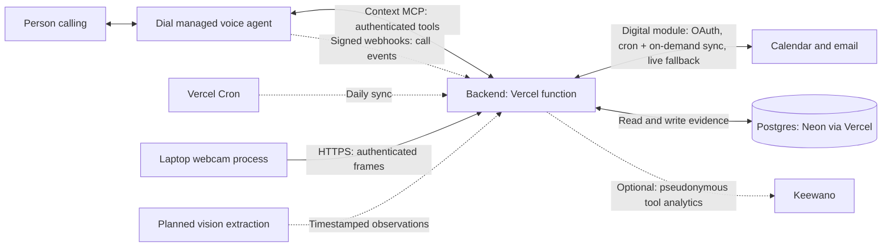

# speedhacks

Phone memory assistant hackathon scaffold. A person calls a number, asks about a plan or misplaced object, and hears an answer grounded in timestamped evidence.

**Status:** The backend runs on Vercel with Postgres (Neon). Google Calendar and Gmail connect through OAuth and sync into Postgres (see [Google connection](#google-connection)). Demo mode still seeds labeled synthetic memories. Dial calls and object detection are not connected; webcam uploads do not identify objects.

## Proposed architecture



One monorepo, two running processes: a Node backend (a single Vercel function in production, or `npm start` / Docker anywhere else) and a Python webcam process on a laptop. Digital and physical memory are separate backend modules. They can be deployed independently later; the hackathon uses one backend deployment.

Dial owns speech recognition, conversation, and speech playback. Its managed voice agent calls the backend's MCP tools during the call. The camera collects evidence before a call; object lookup retrieves historical observations rather than describing only the current room.

The camera makes outbound HTTPS requests, requiring no public laptop port. The backend keeps only the latest raw frame, while object observations persist separately. Engineer 3 adds vision extraction and posts observations before camera capture can produce searchable memories. Photos and live-message adapters are stretch work.

## Ownership

| Engineer | Owns | Next work |
| --- | --- | --- |
| 1: Phone | `backend/voice/`, `backend/app.mjs` | Connect Dial MCP, configure voice instructions, test a real call |
| 2: Digital memory, database, infra | `backend/digital/`, `backend/store.mjs`, `backend/db.mjs`, `backend/runtime.mjs`, `backend/analytics/`, Vercel and Docker files | Connect a real Google test account; confirm Dial header names on a live call |
| 3: Physical memory | `camera/`, `backend/physical/` | Add vision extraction, placement observations, and last-seen validation |

`contracts/index.mjs` defines shared payload validation and tool inputs. Coordinate changes here before changing producers or consumers.

## Local startup

Requires Node 22.15.x–22.x and npm, plus a Postgres database; optional camera capture uses Python 3.12+.

```sh
npm ci
npm run setup     # .env with distinct secrets and a local DATABASE_URL
npm run db:up     # local Postgres 16 in Docker (or point DATABASE_URL at your Neon database)
```

Setup creates an ignored, owner-readable `.env`. It never changes existing values; rerunning it on an older `.env` only appends settings added since (`DATABASE_URL`, `ADMIN_TOKEN`, `GOOGLE_TOKEN_KEY`, `CRON_SECRET`). Set `DEMO_CALLER_NUMBER` there to a consented test caller's E.164 number, then:

```sh
npm start
```

Health: `http://127.0.0.1:3000/health`. MCP: `http://127.0.0.1:3000/mcp`. Watch mode: `npm run dev`. The schema migrates on first request; `npm run db:migrate` does it ahead of time.

`DEMO_MODE=true` seeds synthetic calendar, email, and keys memories dated today in the user's zone. Seeded records have `demo: true`. Setting the flag to false stops seeding but does not erase existing fixtures. The store is single-user.

## Deploying to Vercel

1. Import the repository in Vercel. `server.js` exports the Express app, which Vercel deploys as one function (zero-config Express, Fluid compute); no build settings are needed.
2. Add Postgres from the Vercel Marketplace (Neon) and connect it to the project. It sets `DATABASE_URL` (older Vercel Postgres projects set `POSTGRES_URL`, which also works). Connections go through a module-scope `pg` pool released by `attachDatabasePool`.
3. Add the variables from `.env.example` as Vercel environment variables: at least `DIAL_MCP_TOKEN`, `CAMERA_TOKEN`, `DEMO_CALLER_NUMBER`, and for Google `ADMIN_TOKEN`, `GOOGLE_*`, `CRON_SECRET`, `CALLER_PIN`. Generate secrets with `npm run setup` locally and copy them.
4. Deploy. The first request runs migrations (an advisory lock keeps concurrent cold starts safe) and seeds demo data if enabled. `GET /health` reports database reachability.

`vercel.json` schedules `GET /cron/google-sync` once a day (the Hobby plan's limit; Vercel sends `Authorization: Bearer $CRON_SECRET`). Between cron runs, a tool call that finds the Google copy older than `GOOGLE_SYNC_MINUTES` starts a background sync (`waitUntil`) for the next caller; a database lease lets only one instance do so per interval. On a Pro plan, change the schedule to `*/10 * * * *`. Long-running servers (`npm start`, Docker) sync on a timer instead.

Keewano batches are kept in memory on Vercel and shipped within about two seconds, since serverless instances may suspend; set `KEEWANO_DATA_DIR` only on a server with a persistent disk.

## Contracts

| Endpoint/tool | Authentication | Purpose |
| --- | --- | --- |
| `GET /health` | None | Liveness and demo status |
| `POST /mcp` | `Bearer DIAL_MCP_TOKEN` | Stateless Streamable HTTP MCP; other methods return 405 |
| `get_schedule({date})` | Authorized inbound demo caller | Plans for an explicit `YYYY-MM-DD` date |
| `search_messages({query})` | Authorized inbound demo caller | Search fixture emails |
| `find_object({object})` | Authorized inbound demo caller | Latest matching observation by capture time |
| `POST /camera/frame` | `Bearer CAMERA_TOKEN` | Store latest JPEG, at most 500 KB |
| `GET /camera/frame` | `Bearer CAMERA_TOKEN` | Retrieve latest JPEG with `X-Captured-At` |
| `POST /camera/observations` | `Bearer CAMERA_TOKEN` | Persist a placement observation |
| `POST /google/connect` | `Bearer ADMIN_TOKEN` | Start Google OAuth; returns a 10-minute consent link |
| `GET /google/callback` | Single-use OAuth state | Google redirect target; stores the encrypted refresh token |
| `GET /google/status` | `Bearer ADMIN_TOKEN` | Connection, granted scopes, sync results, record counts |
| `POST /google/sync` | `Bearer ADMIN_TOKEN` | Sync Calendar and Gmail now |
| `DELETE /google/connection` | `Bearer ADMIN_TOKEN` | Revoke at Google and delete synced Google evidence |
| `POST /webhooks/dial` | `X-Dial-Signature` HMAC | Store Dial call/message events (deduplicated, pruned after retention) |
| `GET /cron/google-sync` | `Bearer CRON_SECRET` | Vercel Cron: sync Google and prune expired Dial events |

With `CALLER_PIN` set, each memory tool also takes `pin`; without it the tool answers "A PIN is required" and the voice agent asks the caller (see `backend/voice/instructions.txt`). Five wrong PINs lock that caller number out for 15 minutes.

Observation body:

```json
{
  "object": "keys",
  "location": "beside the blue mug on the desk",
  "timestamp": "2026-10-11T14:14:00-07:00"
}
```

Frame bodies contain `timestamp` and `jpegBase64`. The upload response explicitly reports `inference: "not_configured"`.

Memory tools return `{"status":"supported","evidence":[...]}` or `{"status":"unknown","evidence":[]}`. Each evidence record has an ID, source, text, timestamp, and demo flag; Google records add `origin` (`google-calendar`/`google-gmail`) and `ref` (a link to the original event or thread). Unauthorized/failed tools return errors, not proof that nothing happened: if Google cannot be reached and nothing is stored locally, the tool errors instead of answering "unknown". Calendar plans do not prove attendance; declined, tentative and unanswered invitations say so; email evidence names the sender's address as well as the display name; camera observations are last-seen locations.

## Google connection

Read-only scopes: `calendar.readonly` and `gmail.readonly` (Gmail search needs the latter; `gmail.metadata` cannot search). Both are sensitive/restricted, so keep the OAuth consent screen in **Testing** with your account added as a test user. Google expires Testing-mode refresh tokens after 7 days; status then reads `reconnect_required` and you connect again.

1. In Google Cloud Console, enable the Calendar API and Gmail API, configure the consent screen (External, Testing, add test users), and create an OAuth client of type **Web application**. Add the authorized redirect URI `http://localhost:3000/google/callback` for local use, or `https://YOUR_BACKEND/google/callback` when hosted.
2. Set `GOOGLE_CLIENT_ID`, `GOOGLE_CLIENT_SECRET` and `GOOGLE_REDIRECT_URI` in `.env` or the Vercel project (`npm run setup` provides `ADMIN_TOKEN` and `GOOGLE_TOKEN_KEY`). A partial Google configuration fails at boot. **Set `CALLER_PIN` too:** caller ID can be spoofed, and the PIN is what keeps a stranger from hearing this mailbox.
3. `npm start` (or deploy), then `npm run google -- connect` and open the printed link within 10 minutes. Use `BACKEND_URL=https://YOUR_BACKEND` for a hosted backend.
4. `npm run google -- status` shows the account, scopes, last sync and record counts. `sync` forces a sync; `disconnect` revokes access and deletes synced Google evidence.

How retrieval works during a call:

- A sync replaces the stored copy of calendar events from 7 days ago to 60 days ahead, and of mail matching `GMAIL_SYNC_QUERY` (default: the last 30 days, excluding promotions and social), capped at `GMAIL_SYNC_LIMIT` (at most 250, to stay inside Gmail's per-minute quota). Cancelled or deleted items disappear on the next sync. Syncs run after connecting, from Vercel Cron, on demand when the copy is stale, or on a timer for long-running servers.
- Tools answer from Postgres. A date outside the synced window (or when the copy is stale), or an email search with no stored match, queries Google live under one `GOOGLE_LIVE_TIMEOUT_MS` deadline (default 1.5 s) so the caller does not hear dead air. Live mail search stays inside `GMAIL_SYNC_QUERY`.
- If access expires (`reconnect_required`), stored evidence is still served, but a question with nothing stored returns an error rather than "no plans".
- Dates use `TIMEZONE`, else the Google calendar's zone, else UTC. `get_schedule`'s description tells the voice model today's date in that zone.
- Email text is the sender's name, subject and Gmail's snippet (at most 300 characters), never full bodies. The refresh token is stored encrypted with AES-256-GCM.

## Database

Postgres: Neon through the Vercel Marketplace in production, `npm run db:up` (Postgres 16 in Docker) locally, and in-process PGlite in tests. `backend/db.mjs` wraps `pg` (pooled, released by `attachDatabasePool` on Vercel) and PGlite behind the same `query`/`transaction` interface; `backend/store.mjs` holds all SQL.

Schema changes are numbered migrations in `backend/store.mjs`, recorded in `schema_migrations` and applied in one transaction under a Postgres advisory lock, so serverless instances that cold-start together cannot race. A database newer than the code refuses to serve. Add a migration to the end of the list; never edit one that has shipped. Evidence is `jsonb` with a `timestamptz` column for ordering; batch writes send all rows in one statement.

| Table | Holds |
| --- | --- |
| `evidence` | Memory records, with `origin` (`local`, `google-calendar`, `google-gmail`) |
| `latest_frame` | The newest webcam frame |
| `google_connection` | Account, granted scopes, zone, encrypted refresh token, status |
| `oauth_state` | Single-use OAuth state and PKCE verifier (10-minute expiry) |
| `sync_state` | Last attempt, success, error, item count and synced window per sync; also the background-refresh lease (`google-refresh`) |
| `dial_event` | Signed Dial webhook events, pruned after `DIAL_EVENT_RETENTION_DAYS` (on each delivery and each cron run) |
| `caller_pin_failure` | Wrong-PIN counts per hashed caller number, for the 15-minute lockout |

Backups: Neon keeps point-in-time history and can branch a database; locally use `pg_dump`.

## Dial connection: follow-up work

1. Deploy to Vercel (HTTPS by default), or use a development HTTPS tunnel to a local port.
2. In Dial Context MCP settings, add `https://YOUR_BACKEND/mcp` with static header `Authorization: Bearer YOUR_DIAL_MCP_TOKEN`.
3. Configure the number's inbound instruction with `backend/voice/instructions.txt`.
4. Set `DEMO_CALLER_NUMBER`, then call from that number with `DIAL_LOG_HEADERS=true` once. The log lists the header names Dial sent, with phone numbers cut to their last four digits. If the caller and direction headers differ from the defaults, set `DIAL_CALLER_HEADER` and `DIAL_DIRECTION_HEADER`, then turn logging off.
5. Optional: in the Dial dashboard, add a webhook to `https://YOUR_BACKEND/webhooks/dial` and put its signing secret in `DIAL_WEBHOOK_SECRET`. Events such as `call.ended` and `call.transcribed` are stored once each; transcripts contain personal speech, so retention defaults to 30 days.

Dial is expected to supply `X-Dial-User-Number` and `X-Dial-Direction` during calls; these names come from the scaffold and are not confirmed by public Dial docs, hence step 4. The backend checks the configured caller and inbound direction. Tool discovery works without caller headers; data retrieval does not. Connection credentials alone never authorize a caller. Dial offers no caller verification, and caller ID can be spoofed.

**The caller-number allowlist is not verified identity.** Set `CALLER_PIN` before connecting real Google data. The store is single-user. Keep the bearer secrets server-side.

Reference: [Dial Context MCP documentation](https://docs.getdial.ai/documentation/platform/context-mcp). This scaffold does not create phone resources or place calls.

## Camera process

```sh
python3 -m venv .venv
.venv/bin/python -m pip install -r camera/requirements.txt
PYTHON=.venv/bin/python npm run camera -- --once
```

Omit `--once` for repeated capture. Defaults: webcam 0, one frame every 5 seconds. The npm command loads `.env`. Use `BACKEND_URL=https://YOUR_BACKEND` for remote uploads; remote plain HTTP is rejected. Running capture requests OS webcam permission.

Engineer 3 adds inference and posts observations. The current uploader explicitly reports that inference is unconfigured. Test a visible tabletop first, including hidden objects and missed placements.

## Docker (local stack or non-Vercel hosting)

```sh
npm run setup
docker compose up --build
```

Compose runs Postgres 16 and the backend with a healthcheck, both bound to laptop loopback; the backend's `DATABASE_URL` points at the compose database. The Dockerfile also runs anywhere that injects the same environment variables and a `DATABASE_URL`, with HTTPS terminated at ingress. Keep the camera on the laptop. When hosted, register `https://YOUR_BACKEND/google/callback` with Google and keep `ADMIN_TOKEN` off shared machines.

## Sponsor tools

| Sponsor | Use here | Status |
| --- | --- | --- |
| Dial | Phone number, managed voice agent, Context MCP to `/mcp`, signed webhooks to `/webhooks/dial` | Wired; header names to confirm on a live call |
| Keewano | Product analytics: tool used, latency, evidence count, empty answers, evidence origin, rejected callers, sync results, Dial event types | Wired; set `KEEWANO_API_KEY` to enable |
| Alike | Shared memory for the team's coding agents during the build (`npx @alikeai/setup`) | Dev-time only; `.alikeignore` keeps secrets out of captured sessions |
| Sparta | Worlds (local SaaS replicas such as Gmail) for testing the email adapter against a mock inbox | Not wired: it needs configurable Google endpoints, which also redirect OAuth tokens and need a team decision |

Keewano receives no phone numbers or personal content: callers become HMAC-derived UUIDs, rejected callers share one anonymous ID, and events carry only tool names, counts, latency and origin labels. Event definitions live in `backend/analytics/keewano.events.json`; append (never reorder), then run `npm run keewano:codegen`, which converts Keewano's generated TypeScript to plain JS with Node's built-in type stripping. CI fails if the generated file is stale.

## Checks

```sh
npm test
python3 -m unittest discover -s camera -p 'test_*.py'
```

`npm test` uses in-process PGlite; `TEST_DATABASE_URL=postgres://… npm test` runs the same suite against a real server, each test in its own schema. GitHub Actions runs both, checks the generated Keewano module, runs the camera tests, and boots the compose stack and probes `/health` across a restart. Checks cover MCP discovery and retrieval, caller restrictions and PIN lockout, unknown evidence, validation, timestamp ordering, persistence, camera upload limits, Google OAuth (PKCE, single-use state, partial consent, revocation, undecryptable tokens) and sync against an in-process fake Google, time zones and DST, concurrent migrations, database wake-up retries, the refresh lease, cron auth, Dial webhook signatures and analytics privacy. A real Google account, real calls, a Vercel deployment, webcam accuracy, and clinical usefulness remain unverified.
