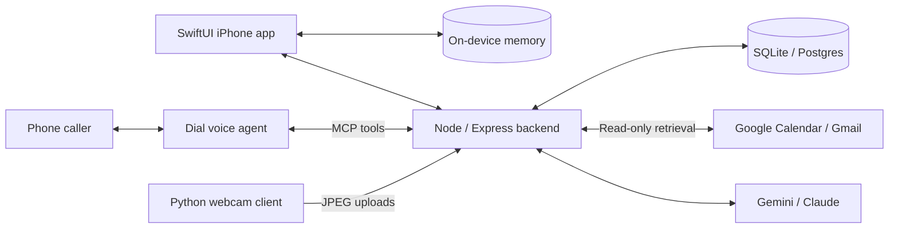

# Recall

**Built for the Andreessen Horowitz (a16z) SpeedHacks hackathon.**

A memory assistant for the moments you almost remember. Recall brings together an iPhone app, a conversational phone assistant named **Steph**, and camera-based object memory to answer questions using timestamped evidence.


*Screenshots from the iPhone simulator using fictional demo memories.*

## The experience

- **Ask naturally.** “Where are my keys?” “Who's Sam again?” “What am I doing today?” Use voice or text in the app, or talk to Steph over a phone call when Dial is configured.
- **See the source.** Answers connect to a photo, calendar event, note, or last confirmed camera sighting, with its timestamp. Missing evidence produces an unknown result.
- **Remember before you ask.** Reminder cards surface context before an event, including a person's details or a promise to follow up.

The iPhone demo runs with seeded memories and on-device answers. The separate offline phone-reminder walkthrough runs in the terminal without provider accounts or real calls.

## Architecture



| Layer | Technology |
| --- | --- |
| iPhone | SwiftUI, SwiftData, Apple Speech, Vision, local notifications |
| Backend | Node.js 22, Express, Model Context Protocol, Zod |
| Storage | SQLite for local development; Postgres for hosted state |
| Camera | Python, OpenCV, Gemini vision |
| Integrations | Dial, Google OAuth, optional Voyage embeddings and Keewano analytics |

The iPhone searches its local memories on-device. Optional device pairing adds access to the backend's shared calendar, email, and camera evidence. Phone photos stay on the phone; the separate webcam client uploads JPEGs to the backend.

## Engineering details

- **Confirmed object memory.** A new object location needs two matching, clearly visible sightings. Missing or occluded objects preserve the last confirmed location and time.
- **Durable processing.** Database leases, transactions, and request-scoped inference keep camera state consistent across serverless instances and restarts.
- **Careful reminder delivery.** Persisted call and message states distinguish submission from delivery and prevent blind retries after an ambiguous send.
- **Shared retrieval.** Phone and paired-app queries use the same patient-scoped lookup functions. Device credentials are separate from service tokens.

## Run locally

Requires **Node.js 22.15–22.x** and npm. The backend uses SQLite by default.

```sh
npm ci
npm run setup
npm start
```

Setup creates an ignored `.env` with separate local service tokens. The backend listens on port 3000 by default; `/health` checks the database. The root route returns 404 because this service is an API.

For an offline walkthrough with no phone calls or texts:

```sh
npm run demo:medicine
```

See [RUN.md](RUN.md) for the local demo and [iPhone setup](ios/README.md) for the app. Python 3.12+ is needed for camera tooling; iOS builds require macOS and Xcode.

## Validation and project status

Recall is a hackathon prototype. The repository includes backend tests for both database adapters, camera-upload tests, and iOS unit and UI tests. Live provider access, phone delivery, and physical-device behavior require their own integration checks. The screenshots show seeded demo behavior.

```sh
npm test
python3 -m unittest discover -s camera -p 'test_*.py'
```

[Validation notes](docs/testing/README.md) explain the checks, known gaps, and dated results. Real tabletop recognition accuracy remains a separate acceptance test.

## Explore the repository

| Path | Contents |
| --- | --- |
| [ios/](ios/) | iPhone app, on-device memory, cards, and tests |
| [backend/](backend/) | API, MCP tools, digital memory, camera pipeline, and storage |
| [camera/](camera/) | Webcam capture and upload client |
| [contracts/](contracts/) | Shared payload validation and tool inputs |
| [scripts/](scripts/) | Setup, demos, integration utilities, and smoke checks |
| [docs/](docs/) | Development guides, operation, and validation records |

## Documentation

- [Quick start](RUN.md)
- [Development guide and API contracts](docs/development.md)
- [iPhone app and demo](ios/README.md)
- [Camera operation and acceptance](docs/object-memory.md)
- [Shared-memory device pairing](docs/ios-memory.md)
- [Tests and known limitations](docs/testing/README.md)
- [Engineering guide and decision log](AGENTS.md)

Font and demo-image attribution is recorded in [asset credits](ios/Recall/Resources/CREDITS.md).
