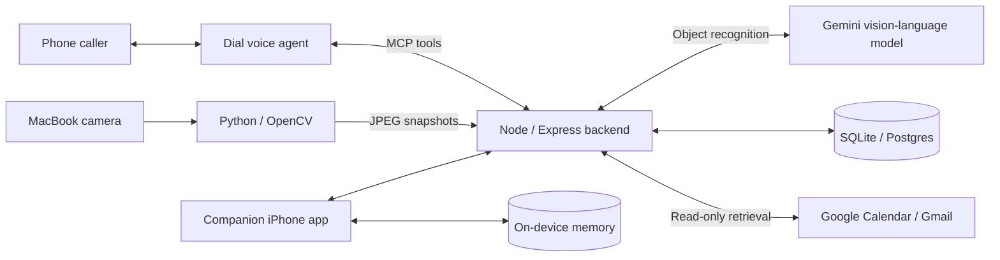

# Recall

**Built for the Andreessen Horowitz (a16z) SpeedHacks hackathon.**

A memory assistant you can call. The main interface is simple: **call Steph's number and ask a question**. “Where did I leave my keys?” “Where's my wallet?” “What am I doing today?” Steph answers using timestamped evidence from connected cameras, calendars, and notes.

**Public phone demo: currently disabled.**

## From camera to phone call

1. **Connect a MacBook camera.** A Python/OpenCV client captures snapshots of a fixed tabletop and uploads them to the backend.
2. **Identify objects with a VLM.** A vision-language model (VLM), powered by Gemini vision, identifies everyday objects you might have forgotten or misplaced, such as keys, a phone, or a wallet. Matching sightings establish an object's last confirmed location and capture time.
3. **Just call and ask.** Steph retrieves the relevant memory and tells you where the object was last seen and when. Missing or occluded objects preserve the previous confirmed sighting; insufficient evidence produces an unknown result.

**Planned: smart home camera support.** The current camera client uses the MacBook's camera. Connecting smart home cameras to provide object memories from around the home is a future extension.

## Companion iPhone app

The companion app offers voice and text questions, answer cards with source citations, and reminders with context before an event. Its demo runs with fictional memories and on-device answers.


*Screenshots from the iPhone simulator using fictional demo memories.*

## Architecture



| Layer | Technology |
| --- | --- |
| Phone interface | Dial voice agent and MCP memory tools |
| Camera and object recognition | MacBook camera, Python, OpenCV, Gemini VLM |
| Backend | Node.js 22, Express, Model Context Protocol, Zod |
| Storage | SQLite for local development; Postgres for hosted state |
| Companion iPhone app | SwiftUI, SwiftData, Apple Speech, Vision, local notifications |
| Integrations | Google OAuth, Gemini / Claude answers, optional Voyage embeddings and Keewano analytics |

The MacBook camera supplies visual evidence for phone questions. The iPhone searches its own local memories on-device; optional device pairing adds access to the backend's shared calendar, email, and camera evidence. Phone photos stay on the phone; the MacBook camera client uploads JPEGs to the backend.

## Engineering details

- **Confirmed object memory.** A new object location needs two matching, clearly visible sightings. Missing or occluded objects preserve the last confirmed location and time.
- **Durable processing.** Database leases, transactions, and request-scoped inference keep camera state consistent across serverless instances and restarts.
- **Careful reminder delivery.** Persisted call and message states distinguish submission from delivery and prevent blind retries after an ambiguous send.
- **Shared retrieval.** Phone and paired-app queries use the same patient-scoped lookup functions. Device credentials are separate from service tokens.

## Run locally

Requires **Node.js 22.15–22.x** and npm. The backend uses SQLite by default.

```sh
npm ci
npm run setup
npm start
```

Setup creates an ignored `.env` with separate local service tokens. The backend listens on port 3000 by default; `/health` checks the database. The root route returns 404 because this service is an API.

For an offline walkthrough with no phone calls or texts:

```sh
npm run demo:medicine
```

See [RUN.md](RUN.md) for the local demo and [iPhone setup](ios/README.md) for the app. Python 3.12+ is needed for camera tooling; iOS builds require macOS and Xcode.

## Validation and project status

Recall is a hackathon prototype, and the public phone demo is currently disabled. MacBook camera capture and VLM object memory are implemented; smart home camera integration is planned. The repository includes backend tests for both database adapters, camera-upload tests, and iOS unit and UI tests. Live provider access, phone delivery, and physical-device behavior require their own integration checks. The screenshots show seeded demo behavior.

```sh
npm test
python3 -m unittest discover -s camera -p 'test_*.py'
```

[Validation notes](docs/testing/README.md) explain the checks, known gaps, and dated results. Real tabletop recognition accuracy remains a separate acceptance test.

## Explore the repository

| Path | Contents |
| --- | --- |
| [ios/](ios/) | iPhone app, on-device memory, cards, and tests |
| [backend/](backend/) | API, MCP tools, digital memory, camera pipeline, and storage |
| [camera/](camera/) | MacBook camera capture and upload client |
| [contracts/](contracts/) | Shared payload validation and tool inputs |
| [scripts/](scripts/) | Setup, demos, integration utilities, and smoke checks |
| [docs/](docs/) | Development guides, operation, and validation records |

## Documentation

- [Quick start](RUN.md)
- [Development guide and API contracts](docs/development.md)
- [iPhone app and demo](ios/README.md)
- [Camera operation and acceptance](docs/object-memory.md)
- [Shared-memory device pairing](docs/ios-memory.md)
- [Tests and known limitations](docs/testing/README.md)
- [Engineering guide and decision log](AGENTS.md)

Font and demo-image attribution is recorded in [asset credits](ios/Recall/Resources/CREDITS.md).
