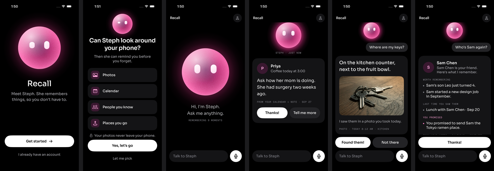
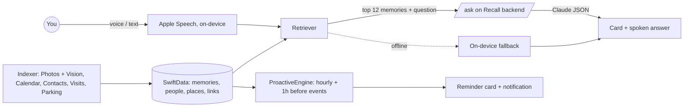

# Recall for iPhone

One agent, one screen. **Steph** remembers your life so you don't have to: she answers when you ask ("Where are my keys?", "Who's Sam again?") and speaks first before you forget ("You're seeing Priya at 3. Ask how her mom is doing.").

Everything Steph shows is a card that rises from her orb, ends with a mono source line, and has one main action. Heavy work (photo understanding, indexing) happens quietly, mostly while the phone charges.



## Run it

Requirements: Xcode 26 (built with 26.6), iOS 17+. The generated `Recall.xcodeproj` is committed; [XcodeGen](https://github.com/yonaskolb/XcodeGen) is only needed after adding or removing files (`cd ios && xcodegen generate`).

1. `cp ios/Config/Local.xcconfig.example ios/Config/Local.xcconfig` (gitignored) and set:
   - `RECALL_TEAM`: your Apple team ID, and `RECALL_BUNDLE_ID`: a bundle ID that team can sign.
   - `RECALL_APP_TOKEN`: the backend's `RECALL_APP_TOKEN` (see below). Leave it empty to run fully on-device.
   - Free personal teams cannot use Sign in with Apple: set `RECALL_ENTITLEMENTS = Recall/Recall-NoSIWA.entitlements`.
2. Open `ios/Recall.xcodeproj`, pick the **Recall** scheme and your iPhone, and run.

The simulator works for everything except the microphone-heavy parts and real photo/calendar data. Type to Steph instead of talking.

### Backend (Claude, embeddings)

Steph's brain is the existing Recall service in this repo (`backend/steph/`): `POST /embed`, `/ask` and `/reminders`. The service holds every API key and proxies Claude, so the app never contains one. See [Steph API](../README.md#steph-api-ios-app) for the contract.

| Variable | Where | Purpose |
| --- | --- | --- |
| `RECALL_APP_TOKEN` | Backend + `ios/Config/Local.xcconfig` | Shared app secret, ≥32 characters. Empty disables the three endpoints (503) |
| `ANTHROPIC_API_KEY` | Backend only | Claude for `/ask` and `/reminders` |
| `STEPH_MODEL` | Backend only | Default `claude-opus-5-5` (low effort, structured JSON output) |
| `VOYAGE_API_KEY` | Backend only | Voyage embeddings for `/embed`; optional |
| `EMBED_MODEL` | Backend only | Default `voyage-3.5-lite` |
| `RECALL_API_BASE_URL` | `ios/Config/Local.xcconfig` | Default production `https://recall-kappa-nine.vercel.app`. Write `https:/$()/host` because xcconfig treats `//` as a comment. Use `http:/$()/127.0.0.1:3000` for a local backend (`npm start`) from the simulator |

Production is not configured for Steph yet: set those variables in the Vercel project's Production environment and redeploy. Until then, or with no network, the app answers **on-device**. The fallback only repeats what a stored memory says, never composes new facts, and says "I'm not sure" with the closest memory when nothing matches well.

## Demo mode (3-minute script)

Demo mode loads seeded memories, dated relative to today, so the live demo never depends on a fresh phone:

- Photo: keys on the kitchen counter next to the fruit bowl, today 8:12 AM.
- Calendar: coffee with Priya today at 3:00 PM.
- Note: Priya's mom had surgery (two weeks ago, Sep 27 when today is Oct 11).
- Person: Sam Chen: new design job in September, son Leo just turned 4, you promised to send him the Tokyo ramen place. Last seen at lunch three weeks ago.
- Parking: Level 3, spot 42.

**Turn it on:** triple-tap the **Recall** wordmark (or Settings → Demo memories). While demo mode is on, Steph only searches demo memories.

1. Open the app: just Steph's orb, breathing.
2. Phone buzzes: Settings → **Buzz me in 10 seconds**, then lock the phone or go home. The Priya notification arrives, and tapping it opens the card. **Show Priya reminder** shows the card immediately instead.
3. Tap the mic: "Where are my keys?" Tap again when done. The keys card has the photo, and "Not there" makes Steph look again.
4. "Who's Sam again?" The person card shows what's worth remembering, when you last saw him, and the promise you forgot.

Closing line: *"You can't ask about what you forgot. Steph can."*

The bundled demo photo (Unsplash, see `Recall/Resources/CREDITS.md`) shows keys on a wooden table with no fruit bowl. For the demo, replace `Recall/Resources/Assets.xcassets/DemoKeys.imageset/DemoKeys.jpg` with a photo of your own keys next to a fruit bowl.

## How Steph works



- **Remembering.** Nothing records continuously. Vision runs on-device over photo thumbnails (scene labels, text, anonymous face groups) in a `BGProcessingTask` that requires external power. A light pass of the newest 40 photos runs at launch. iCloud-only photos are skipped rather than downloaded. Calendar (attendees, locations), Contacts (names, birthdays, relationships), Core Location visits and significant changes, and parking (saved when a CarPlay or car-named Bluetooth audio route drops) fill the graph tables: people ↔ memories ↔ places. Statements you say or type ("I put my passport in the desk drawer") become notes.
- **Asking.** On-device speech → hybrid retrieval (embedding cosine + word overlap with synonyms + people and time filters + recency, weighted by confidence) → the top 12 memories (plus a mentioned person's linked memories) go to `/ask` → `{answer, card_type, memory_ids, buttons}` → a card. The source line and "how I know" line come from the cited memories' own metadata, never from the model. The answer is spoken with the best available warm female system voice, and the orb follows the real TTS audio level.
- **Speaking first.** `ProactiveEngine` scores candidates by usefulness × timeliness × confidence − annoyance. Candidates are: an upcoming meeting plus what you know about them, an open promise, a birthday within 3 days, where you parked, and keys when you leave home. It allows at most 3 per day, none in quiet hours (9pm–8am), and schedules each one an hour before the event. `/reminders` phrases what to say or do; without it, the memory's own follow-up text is used.
- **Feedback.** Thanks / Found them raise a memory's confidence; Not there lowers it (×0.6) and Steph looks again without it. Feedback on reminder types feeds the annoyance score.
- **Privacy.** Photos never leave the phone; only short text summaries of the dozen memories needed for one answer are sent, and the backend stores none of them. iOS does not allow reading iMessages, and Recall doesn't try.

## Decisions

The spec said to decide rather than ask. These are the calls made, and why:

1. **One backend.** Steph's endpoints were added to the existing Recall Express service on Vercel instead of a new service, matching the team's one-hosted-service setup. Paths are the spec's `/embed`, `/ask`, `/reminders`. Existing deployments keep booting because every new variable is optional.
2. **Search on the phone, no pgvector.** Memories and embeddings live in SwiftData, and retrieval runs on-device. The backend is stateless and needs no schema migration of the production Neon database. This also means personal memories are never stored server-side. Embeddings come from the backend (Voyage) when configured, otherwise from Apple's on-device sentence embedding, and word overlap keeps search working with neither.
3. **Claude `claude-opus-5-5` at low effort** with structured JSON output and server-side refusal fallbacks. The system prompt is used verbatim. The backend drops any memory ID the phone didn't send and clamps to two buttons.
4. **Person cards are assembled on-device** from the person's linked memories ("worth remembering", "last time", "you promised"). The model writes only the headline sentence, so every line traces to a memory.
5. **Questions aren't stored as memories.** Statements are. Storing "Where are my keys?" would make it the top match for the next keys question.
6. **Demo mode searches only demo memories**, so the live demo can't be derailed by real data on the presenter's phone. The "REMEMBERING n MOMENTS" count stays live and real.
7. **Notifications** are requested right after the four permissions, because reminders need them.
8. **Sign in with Apple** sits behind the design's white "Get started" pill. If Apple sign-in is unavailable (no Apple ID, simulator, personal team), the app keeps a local-only profile. The backend uses a shared app token, which is a demo restriction like the repo's caller allowlist. Real users need per-user auth.
9. **Parking detection** only works while iOS keeps the app alive or suspended in memory: apps aren't woken for audio-route changes. Visit place names use Apple's reverse geocoder, so visit coordinates go to Apple; photos don't.
10. **The orb.** `StephOrb(size:state:level:)` is reusable and has all four states, using the spec's numbers for scale breathing, listening pulse and ripples, thinking glow, and replying wobble and glow. The listening pulse follows the live mic level and the replying glow follows the TTS level. It respects Reduce Motion. Mid-build the file was redesigned on disk by another editor into a pink orb with blinking eyes and film grain. That version is kept, so the spec's cloud rotation is gone. The cloud reference image (`OrbClouds`, recoloured from the design file) is still in the asset catalog and is the app icon's source.

## Tests

```sh
cd ios
xcodebuild -project Recall.xcodeproj -scheme Recall \
  -destination 'platform=iOS Simulator,name=iPhone 17 Pro' CODE_SIGNING_ALLOWED=NO test
```

- **Unit tests** (`RecallTests`): retrieval ranking, local answers, card building and source lines, proactive scoring, quiet hours and the daily cap, the store and graph, and the orb motion formulas.
- **UI test** (`RecallUITests/WalkthroughTests`): walks the demo script and the onboarding screens, attaching a screenshot per step. Export them with `xcrun xcresulttool export attachments --path <result bundle> --output-path <dir>`.
- **Launch arguments:** `-RecallInMemoryStore`, `-RecallDemo`, `-RecallSkipOnboarding`, `-phase permissions`.

## Not verified yet

- **Real devices.** All runs so far were in the simulator (iPhone 17 Pro and iPhone SE). Untested: real Sign in with Apple, on-device speech recognition, background tasks, visit/parking detection, and Vision over a real photo library.
- **Live models.** No live Claude or Voyage call has been made. The app ↔ backend contract was exercised against the real Express routes with a stubbed Claude client.
